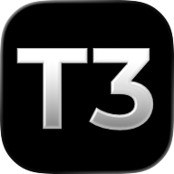

<!-- Fork: Keep the fork feature summary, fork release installation URLs, unsigned IPA guidance, and iOS 17 support/build limitations visible. -->

<p align="center">
  <a href="https://t3.codes">
    
  </a>
</p>

<h1 align="center">T3 Code</h1>

<p align="center">The open-source control plane for coding agents.</p>

<p align="center">
  <a href="https://t3.codes/download"><strong>Download</strong></a> ·
  <a href="https://apps.apple.com/us/app/t3-code-remote-claude-more/id6787819824">iOS</a> ·
  <a href="https://play.google.com/store/apps/details?id=com.t3tools.t3code">Android</a> ·
  <a href="https://app.t3.codes">Web</a> ·
  <a href="./docs/README.md">Docs</a> ·
  <a href="https://discord.gg/jn4EGJjrvv">Discord</a>
</p>

## What this fork adds

This is a fork of [pingdotgg/t3code](https://github.com/pingdotgg/t3code). It adds:

- **A git account per project.** Add several git accounts (author name and email, plus a saved token or an existing `gh` login, and an optional SSH key), set a default, and pick a different one for any project. Agents, terminals, setup scripts, and T3 Code's own commits, pushes, and pull requests in that project use that account, so you don't have to sign out and back in when you switch projects. If the account can't be used, T3 Code warns first and only falls back to your machine's login for a thread you confirm. Open terminals follow account switches too. Works with GitHub, GitLab, Forgejo/Gitea, Bitbucket, Azure DevOps, and GitCafe. See [Use a different git account per project](./docs/user/source-control.md#use-a-different-git-account-per-project).
- **The mobile app on iOS 17.0.** Upstream requires iOS 18. This fork's app runs on iOS 17.0 and later, and on iOS 18 and later it behaves exactly like upstream. Nothing was removed or rewritten for the backport, so iOS 17 gets the same features as iOS 18, with these differences:
  - **iOS 18-only effects.** A few third-party UI components use iOS 18-only system effects and fall back to their simpler iOS 17 behaviour. Liquid glass, voice transcription and the native iPad workspace columns need iOS 26 or later, so iOS 17 and iOS 18 both go without them.
  - **Device list.** iOS 17 devices appear as "iOS 18" in the T3 Connect device list. The hosted relay rejects anything older, so the app reports 18 to register.
  - **Testing so far.** Every library and framework in the app is checked against iOS 17.0's system libraries, and none uses a function iOS 17.0 lacks. On iOS 17.0 iPhone and iPad simulators, a build made with Xcode 26.6 (the version CI and releases use) passed an automated walk of 42 screens with native code, with no crash and no JavaScript error: settings (including git accounts), the thread list and threads, the composer and its attachment menu, sheets, the QR scanner, the file viewer, the review diff, the terminal, and the compose button. Pairing with a server and sending messages work on the iPhone and the iPad, including with the free replay provider. A shorter walk on iOS 26.5 shows nothing changed for newer iOS. Photo and file pickers, dictation, push notifications, Live Activities and sign-in haven't been checked on iOS 17.
  - **React Native built from source.** React Native's prebuilt libraries call two C++ functions that iOS 17.0 doesn't provide where they look for them, which could crash the app the first time that code runs. This fork compiles React Native from source for iOS instead, so those calls find the functions iOS 17.0 has. That makes iOS builds take about 60% longer.

### Installing this fork

This fork publishes nightly builds on its own [GitHub Releases](https://github.com/getBoolean/t3code/releases). The installation steps further down, the package managers, and the app stores all install upstream T3 Code, which doesn't include these changes.

- **Desktop app:** download the installer for your platform from the newest release. It updates itself from this fork's releases. Builds are unsigned, so Windows and macOS warn on first launch, and the macOS app can't update itself.
- **Command line:** every release attaches `install.sh` and `install.ps1`, which install the newest nightly of this fork. They need `T3CODE_CHANNEL=nightly` because the fork has no stable release yet:

  ```bash
  curl -fsSL https://github.com/getBoolean/t3code/releases/download/v0.1.7-nightly.20261102.1/install.sh | T3CODE_CHANNEL=nightly sh
  ```

  ```powershell
  $env:T3CODE_CHANNEL = "nightly"; irm https://github.com/getBoolean/t3code/releases/download/v0.1.7-nightly.20261102.1/install.ps1 | iex
  ```

  `t3 update` then moves to newer nightlies of this fork.

- **iPhone and iPad (iOS 17 or later):** each release attaches `T3-Code-<version>-ios-unsigned.ipa`. It's unsigned, so install it with a sideloading tool such as AltStore, SideStore or Sideloadly, which signs it with your Apple ID. A free Apple ID has to re-sign it every 7 days. This build has no push notifications, widgets or share extension, and doesn't update itself; install a newer release to update.

The published mobile app works with a server from this fork, and can switch a project's account by asking an agent in a thread. The switch only happens once you confirm it.

<p align="center">
  <a href="https://t3.codes">
    
  </a>
</p>

T3 Code runs the coding agents on your machine and gives them one fast interface. Start a thread at your desk, then approve the next step from your phone.

It works with Claude Code, Codex, Cursor, OpenCode, Grok Build, Antigravity, Kiro, Pi, Muse Code, fx, and any [ACP](./docs/user/providers-acp.md) agent. If an agent is set up on your computer, T3 Code can control it.

## What you get

- **Your subscriptions.** T3 Code does not resell tokens. It drives the agents you are already signed in to.
- **Every agent in one place.** Change models in the middle of a thread. Let Claude hand a task to Codex.
- **Desktop, web, and phone.** One server, and every client shows the same threads. There are apps for iOS and Android.
- **Remote ready.** Run agents on any machine. Connect over your local network, Tailscale, or [T3 Connect](./docs/user/remote-access.md).
- **Git built in.** Each thread can work in its own worktree. Review the diff, then commit, push, and open a pull request with one button.
- **Fast.** Performance is a feature here. We measure it, and we treat a dropped frame as a bug.
- **Open.** MIT licensed. If you don't like something, fork it.

## Install

### Desktop app

[Download T3 Code](https://t3.codes/download) for macOS, Windows, or Linux. You can also use a package manager:

| Platform       | Command                                                              |
| -------------- | -------------------------------------------------------------------- |
| macOS          | `brew install --cask t3-code`                                        |
| Windows        | `winget install T3Tools.T3Code` or `scoop install extras/t3code`     |
| Arch Linux     | `yay -S t3code-bin`                                                  |
| Nix            | `nix profile add github:NixOS/nixpkgs/nixos-unstable#t3code`         |
| Debian, Ubuntu | `.deb` from [Releases](https://github.com/pingdotgg/t3code/releases) |

### Command line

This installs the `t3` command. Run `t3` to start the server and open the web app.

```bash
curl -fsSL https://t3.codes/install.sh | sh
```

On Windows, in PowerShell:

```powershell
irm https://t3.codes/install.ps1 | iex
```

To try it once without an install, run `npx t3@latest`.

### Phone

Get the app from the [App Store](https://apps.apple.com/us/app/t3-code-remote-claude-more/id6787819824) or [Google Play](https://play.google.com/store/apps/details?id=com.t3tools.t3code). Then follow [remote access](./docs/user/remote-access.md) to connect it to your computer.

### Sign in to an agent

T3 Code needs one agent that is installed and signed in. For example, install [Claude Code](https://claude.com/product/claude-code) and run `claude auth login`, or install [Codex CLI](https://developers.openai.com/codex/cli) and run `codex login`.

[Provider setup](./docs/user/install.md#providers) has the steps for each agent. [Install T3 Code](./docs/user/install.md) covers nightly builds, AppImage, WSL, and NixOS.

## "Wait, what are you selling me?"

Nothing. We built T3 Code because we wanted the best possible development experience with agents. We were inspired by existing solutions like the Codex desktop app, Conductor, Claude Desktop and Cursor Glass, but none met our bar.

We wanted something performant, remote-ready, and truly open. If we ever go the wrong direction, we want you to have everything you need to fork and build the tool that you want.

## Documentation

- [Install and first run](./docs/user/install.md)
- [Remote access from a phone or another machine](./docs/user/remote-access.md)
- [Permission modes](./docs/user/permission-modes.md)
- [Source control](./docs/user/source-control.md)
- [Connect outside agents over MCP](./docs/user/outside-agents.md)
- [FAQ](./docs/user/faq.md)

[All docs](./docs/README.md) has the full list.

## Contributing

We have limited review capacity. Small, focused fixes are the most likely to be merged. Features need an approved discussion first.

- Read [CONTRIBUTING.md](./CONTRIBUTING.md) before you report a bug or open a pull request.
- Put feature requests in [Ideas](https://github.com/pingdotgg/t3code/discussions/categories/ideas).
- Build from source with the [development runbook](./docs/operations/development.md#first-checkout). The [architecture overview](./docs/internals/overview.md) explains how it works.
- Get help in [Discord](https://discord.gg/jn4EGJjrvv).

## License

[MIT](./LICENSE)
